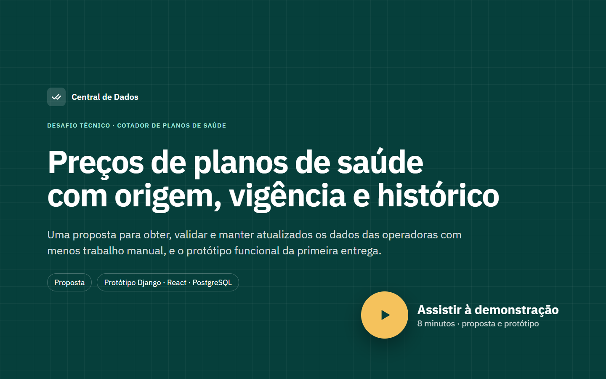
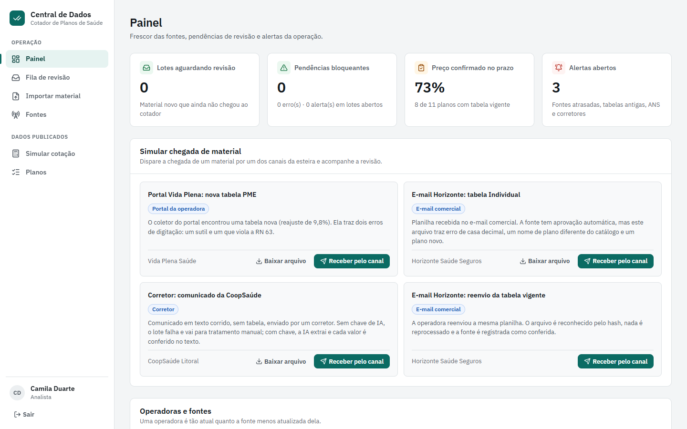
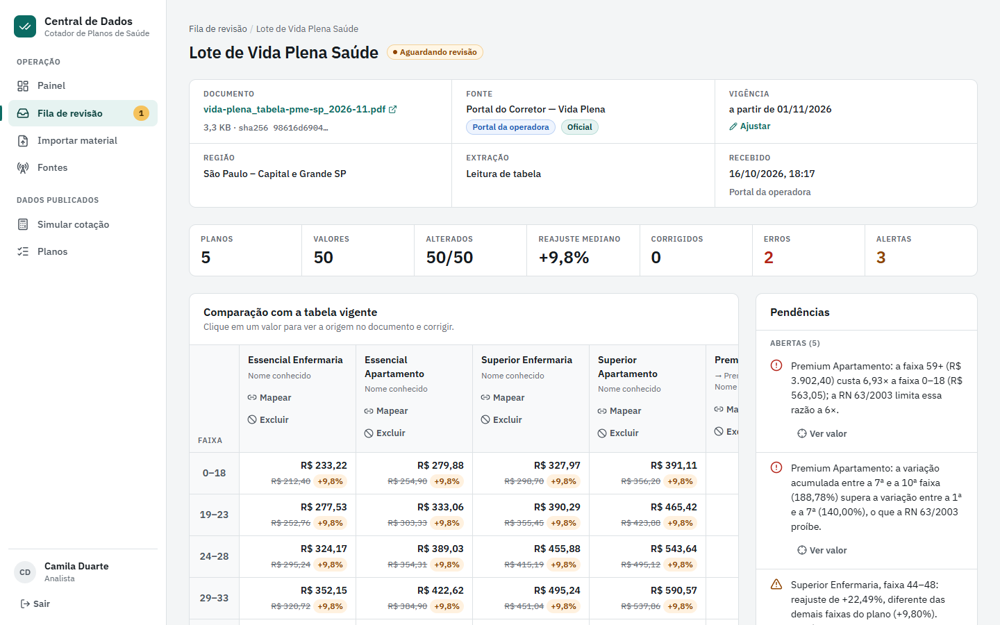
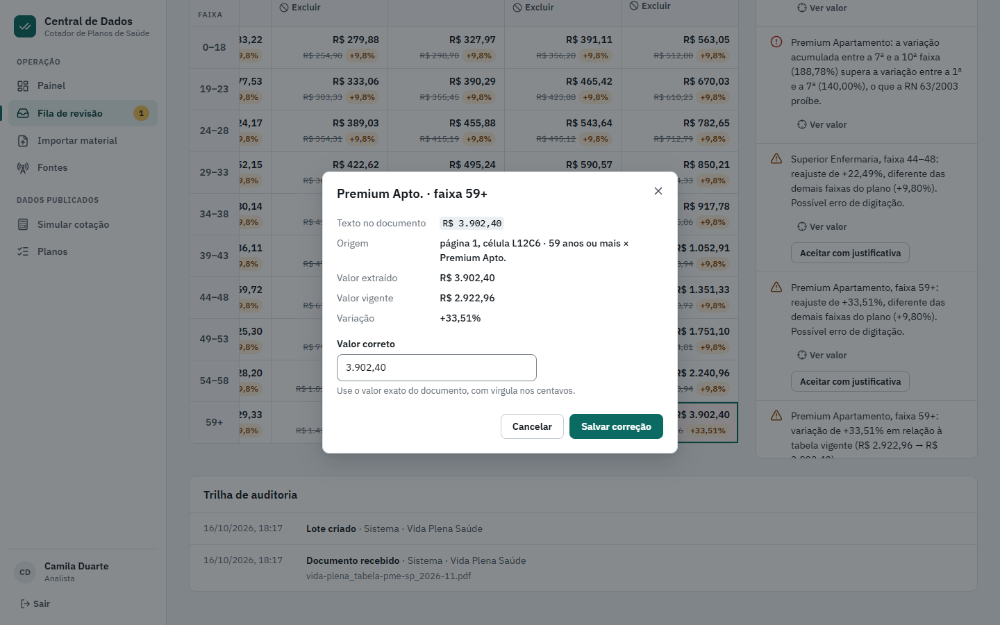
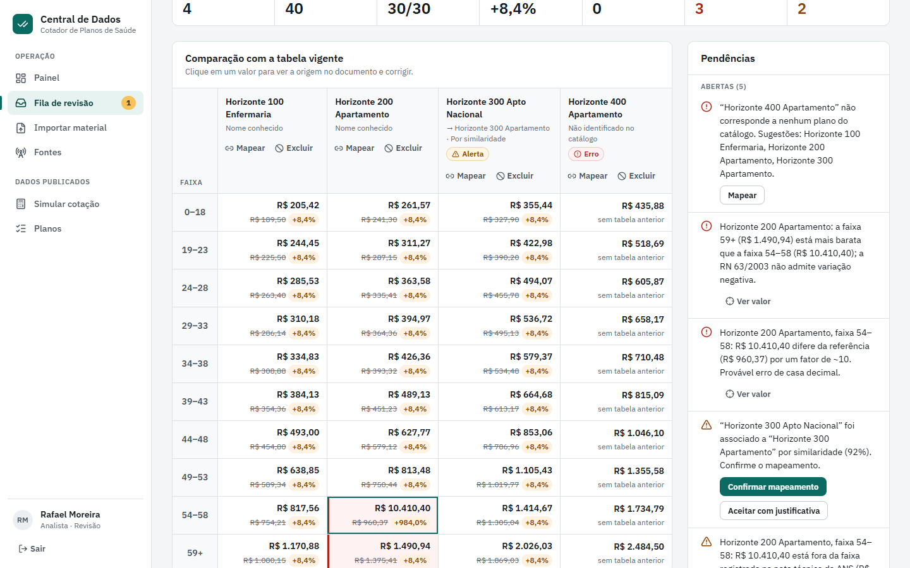
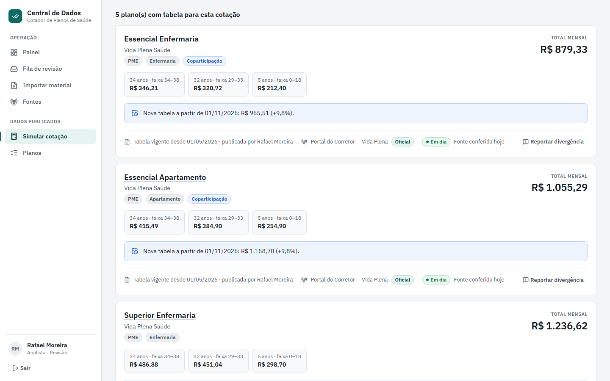
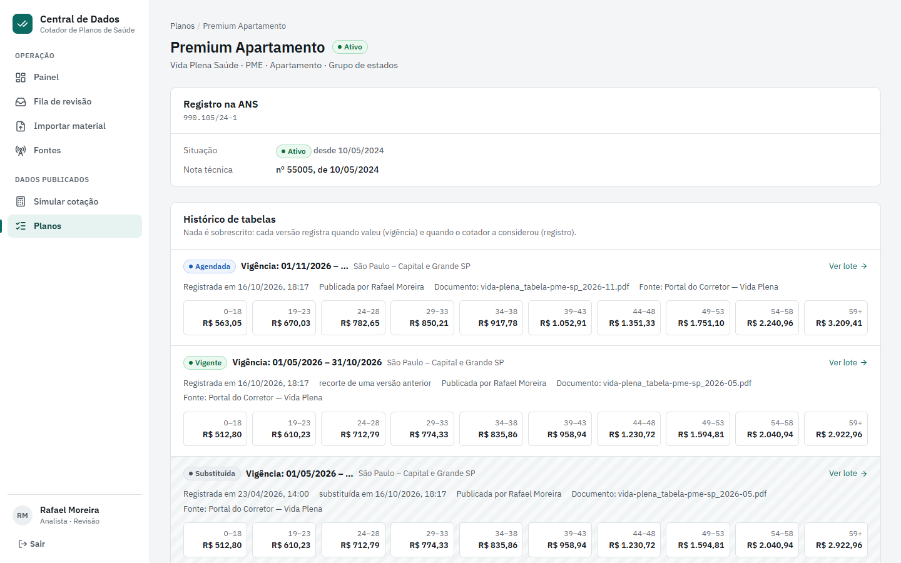
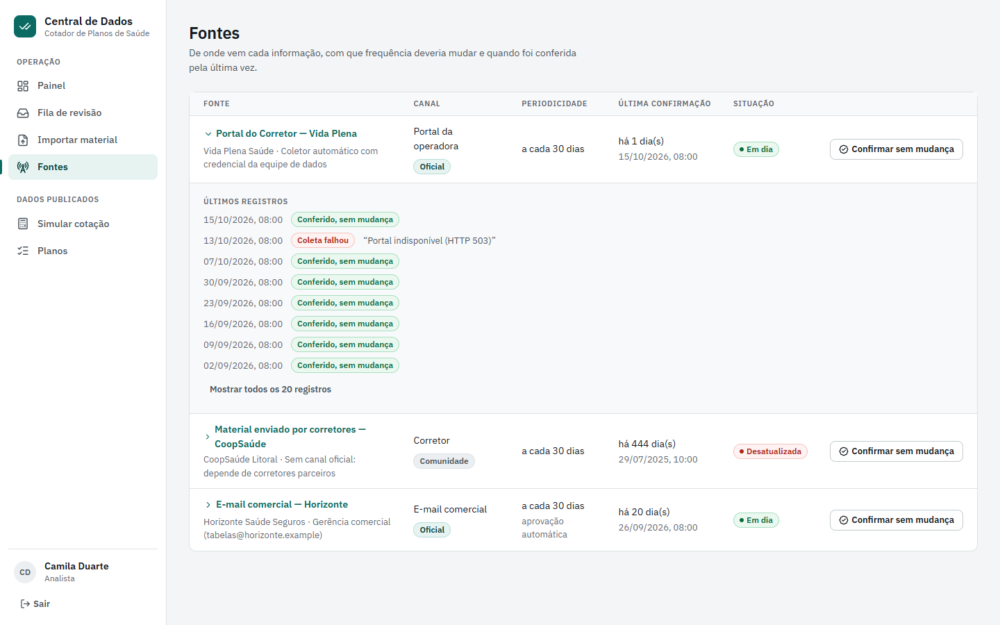
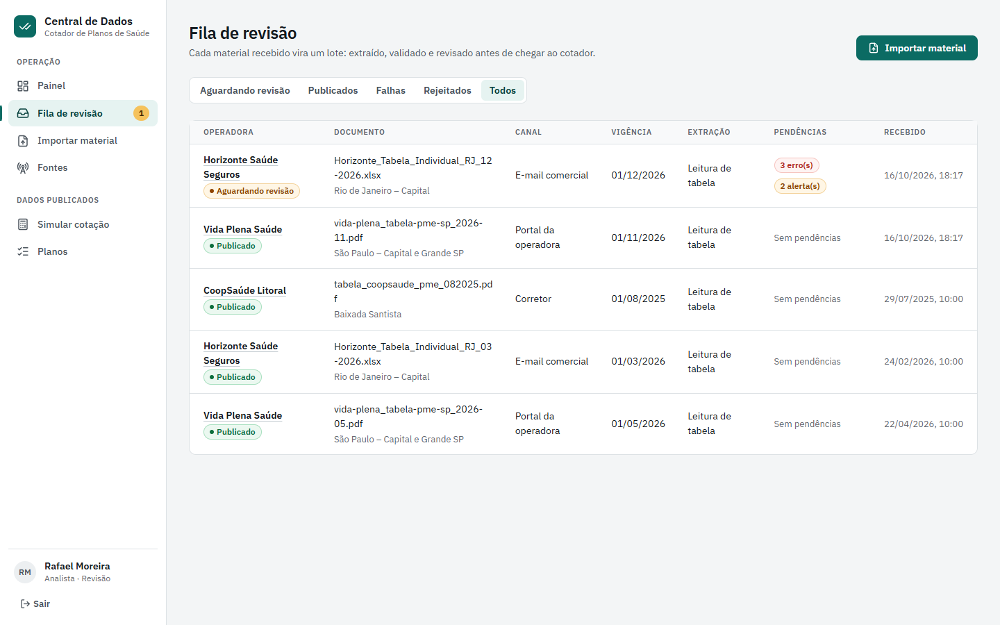

<div align="center">

# Central de Dados do Cotador de Planos de Saúde

**Preços de planos de saúde com origem, vigência e histórico.**

Proposta e protótipo para o desafio técnico do Cotador: como **obter**, **validar** e **manter atualizados** os dados das operadoras (preços, situação dos planos, rede e regras), reduzindo o trabalho manual e registrando a origem de cada informação.

[](https://github.com/Jhonathan1656/TESTE-TECHBRABO/actions/workflows/ci.yml)


**[Proposta](docs/PROPOSTA.md)** · **[Apresentação em PDF](docs/apresentacao.pdf)** · **[Vídeo da demonstração](https://github.com/Jhonathan1656/TESTE-TECHBRABO/releases/download/v1.0.0/central-de-dados-demo.mp4)** · **[Design system](docs/DESIGN-SYSTEM.md)**

[](https://github.com/Jhonathan1656/TESTE-TECHBRABO/releases/download/v1.0.0/central-de-dados-demo.mp4)

</div>

## O que tem aqui

- **[Proposta completa](docs/PROPOSTA.md):** responde aos cinco pontos do desafio (obtenção, redução do trabalho manual, confiabilidade, estrutura técnica e plano de implementação), com riscos, dependências e métricas.
- **Protótipo funcional:** Django + DRF + PostgreSQL + React (TypeScript), sobe com um comando. Implementa a primeira entrega da proposta, a esteira de tabelas de preço, de ponta a ponta.
- **[Apresentação em PDF](docs/apresentacao.pdf):** a proposta e as telas do protótipo comentadas, pronta para encaminhar.
- **[Design system](docs/DESIGN-SYSTEM.md):** tokens, componentes e a verificação de acessibilidade (WCAG 2.2 AA).

> Os dados do protótipo são **de exemplo**: operadoras, planos, registros ANS (faixa 900xxx) e valores foram criados para a demonstração e não correspondem a entidades reais.

---

## A ideia em uma imagem

```
captura ──► extração ──► validação ──► revisão das diferenças ──► publicação versionada ──► cotador
(portal,     (tabela →     (RN 63, ANS,   (a pessoa só vê o que       (vigência + registro,       (preço com origem,
 e-mail,      IA → pessoa)  consistência)  mudou ou foi sinalizado)    nada é sobrescrito)         frescor e próxima tabela)
 corretor)
        ▲                                                                                │
        └──────────── dados abertos da ANS · alertas de frescor · relatos de corretores ◄┘
```

## Telas

<table>
  <tr>
    <td width="50%"><br><b>Painel de operação.</b> Lotes a revisar, pendências, frescor das fontes por operadora e alertas automáticos.</td>
    <td width="50%"><br><b>Revisão por diferença.</b> O PDF do portal virou 50 preços; a equipe confere só os 2 erros e 3 alertas.</td>
  </tr>
  <tr>
    <td><br><b>Origem de cada valor.</b> Texto, página, célula e rótulos do documento, com o valor vigente e a variação.</td>
    <td><br><b>Erros barrados.</b> Casa decimal, plano novo e nome diferente do catálogo retêm o lote antes do cotador.</td>
  </tr>
  <tr>
    <td><br><b>Cotação com origem.</b> Cada preço mostra a tabela, quem publicou, o frescor da fonte e o próximo reajuste.</td>
    <td><br><b>Histórico bitemporal.</b> Versões agendada, vigente e substituída; nada é sobrescrito.</td>
  </tr>
  <tr>
    <td><br><b>Catálogo de fontes.</b> Canal, confiança, periodicidade e cada conferência, inclusive as que falharam.</td>
    <td><br><b>Fila de revisão.</b> Cada material recebido vira um lote extraído, validado e rastreável.</td>
  </tr>
</table>

## Como rodar (Docker)

Pré-requisito: Docker com Compose v2.

```bash
cp .env.example .env
docker compose up --build
```

Acesse **http://localhost:8080** e entre com um dos usuários de demonstração:

| Usuário | Senha | Pode |
|---|---|---|
| `analista` | `cotador-demo` | importar, corrigir valores, mapear planos, aceitar alertas, confirmar fontes |
| `revisor` | `cotador-demo` | tudo do analista, mais publicar, rejeitar e retirar planos do cotador |

A senha vem de `DEMO_PASSWORD` no `.env`. Na primeira subida o backend aplica as migrações e carrega o cenário de demonstração (`seed_demo`, idempotente). Para recomeçar do zero: `docker compose down -v`.

Se as portas 8080 ou 5432 estiverem ocupadas, ajuste `FRONTEND_PORT` e `POSTGRES_PUBLISHED_PORT` no `.env`.

**Extração por IA (opcional):** defina `ANTHROPIC_API_KEY` no `.env` para que materiais sem tabela (comunicados em texto corrido) sejam extraídos por IA. Sem a chave, tudo funciona e esses materiais ficam marcados para tratamento manual.

## Roteiro de demonstração (cerca de 10 minutos)

O cenário é gerado com datas relativas ao dia da execução: sempre existe histórico, uma tabela vigente e um reajuste que entra em vigor no mês seguinte.

1. **Painel** (como `analista`): três operadoras de exemplo, uma delas **desatualizada** (CoopSaúde: material só via corretores, tabela de 14 meses) e três alertas: plano **suspenso na ANS** ainda ativo no cotador, fonte atrasada e tabela antiga.
2. **Simular chegada de material → "Portal Vida Plena: nova tabela PME" → Receber pelo canal.** O lote abre com reajuste mediano de +9,8% em 50 valores e:
   - 2 **erros** da RN 63/2003 no Premium 59+ (R$ 3.902,40 seria 6,93× a primeira faixa);
   - 3 **alertas**, todos consequência dos mesmos dois erros; o mais sutil é o Superior Enfermaria 44–48: +22,49% numa tabela em que todo o resto subiu 9,8% (dígitos trocados).
3. Clique em **Ver valor** ou na célula: veja a origem (página, célula, rótulos), corrija para `3.209,41` e `787,13`. Os erros e alertas se resolvem sozinhos.
4. Saia e entre como **`revisor`** → **Aprovar e publicar**. A tabela fica agendada para o dia 1º do mês seguinte.
5. **Simular cotação** (região São Paulo, idades `34, 32, 5`): o preço vigente vem com a origem e o frescor da fonte, e o aviso *"Nova tabela a partir de 01/MM: R$ … (+9,8%)"*. Preencha **"Ver como o cotador estava em"** com um horário anterior à publicação e o aviso desaparece: é o histórico bitemporal.
6. **Planos → Premium Apartamento:** versões *Agendada*, *Vigente* (recorte) e *Substituída*, cada uma com documento, fonte, aprovador e horário de registro, mais a situação e a nota técnica na ANS.
7. **"E-mail Horizonte: tabela Individual":** a fonte tem aprovação automática, mas o lote fica retido. Ele traz erro de **casa decimal** (R$ 10.410,40, cerca de 10× o vigente e fora da faixa da ANS), um nome de plano diferente do catálogo (**confirmar mapeamento**, o sistema aprende o apelido) e um **plano novo** (mapear ou excluir).
8. **"Corretor: comunicado da CoopSaúde":** texto corrido sem tabela. Sem chave de IA, o lote falha de forma explícita; com a chave, use **Reprocessar documento**.
9. **"E-mail Horizonte: reenvio da tabela vigente":** o arquivo é reconhecido pelo hash, nada é reprocessado e a fonte fica registrada como conferida.
10. **Fontes → Confirmar sem mudança**, e no painel (como `revisor`) **Retirar do cotador** o plano suspenso: os alertas fecham na próxima verificação.

## Implementado × simulado

| Implementado | Simulado ou fora do recorte |
|---|---|
| Recepção por upload, coletor de pasta (`collect_inbox`) e painel de demonstração; documento original guardado pelo hash SHA-256 | Login em portais reais e leitura de caixa de e-mail (o coletor é o mesmo; a origem do arquivo é simulada) |
| Extrator genérico de grade para PDF, XLSX e CSV (faixas em linhas, em colunas ou formato longo; cabeçalho mesclado) | OCR de imagens e fotos |
| Extração por IA com saída estruturada e conferência de cada valor no texto (opcional, testada com resposta gravada) | Chamada real à API só com `ANTHROPIC_API_KEY` |
| 25 regras de validação: estrutura, RN 63, situação e faixa de preço da ANS, consistência, vigência, IA | Regras de carência, coparticipação e reembolso (fase 3 da proposta) |
| Importadores dos arquivos **reais** de dados abertos da ANS (CADOP, características dos produtos, VCM por faixa etária) | O seed importa arquivos de exemplo no formato oficial; a rede hospitalar não foi importada |
| Revisão por diferença com papéis, aprendizado de apelidos, aceite com justificativa, publicação automática para fontes confiáveis | Notificação de corretores impactados por correções |
| Histórico bitemporal com restrição de exclusão no PostgreSQL; consulta "como o cotador estava em" | Chave de preço com faixa de vidas e entidade (o protótipo usa plano e região) |
| Frescor por fonte, alertas idempotentes, relato de divergência do corretor, trilha de auditoria | Processamento em fila (o protótipo é síncrono) |

Detalhes e justificativas: [seção 7 da proposta](docs/PROPOSTA.md#7-o-protótipo).

## Rodando sem Docker (desenvolvimento)

Banco no Docker, aplicação local:

```bash
cp .env.example .env            # descomente POSTGRES_HOST=localhost se precisar
docker compose up -d db

# backend (Python 3.12+)
cd backend
python -m venv .venv && source .venv/bin/activate   # Windows: .venv\Scripts\activate
pip install -r requirements-dev.txt
python manage.py migrate
python manage.py seed_demo
python manage.py runserver      # http://localhost:8000/api

# frontend (Node 22+)
cd ../frontend
npm ci
npm run dev                     # http://localhost:5173 (proxy de /api para o backend)
```

Comandos úteis:

```bash
python manage.py collect_inbox <pasta>    # processa PDFs, XLSX e CSVs como se tivessem chegado por e-mail
python manage.py run_monitoring           # roda as verificações de frescor e de situação na ANS
python manage.py import_ans_reference operators   # importa o CADOP real da ANS (requer internet)
```

## Testes e qualidade

```bash
cd backend && ruff check . && ruff format --check . && pytest      # 215 testes, PostgreSQL real
cd frontend && npm run lint && npm test && npm run build          # 32 testes
```

Nenhum teste chama serviço externo: a ANS e a IA são testadas com arquivos e respostas gravados. O CI (`.github/workflows/ci.yml`) roda lint, formatação, verificação de migrações, testes e build a cada push.

## Estrutura

```
backend/
  config/                Django settings (tudo por variável de ambiente)
  apps/
    core/                domínio comum: faixas etárias (RN 63), dinheiro, mensagens pt-BR, papéis e login
    catalog/             operadoras, planos, apelidos e associação de rótulos a planos
    sources/             catálogo de fontes, verificações e frescor
    ans_reference/       espelho e importadores dos dados abertos da ANS
    ingestion/           documentos, lotes, extração (grade e IA), coletor e revisão
    quality/             regras de validação (funções puras) e pendências
    pricing/             tabelas publicadas (bitemporais), publicação e cotação
    monitoring/          alertas, painel e relatos de corretores
    audit/               trilha de auditoria (só inserção)
    demo/                cenário de exemplo, gerador de documentos e seed
frontend/src/
  features/              painel, fila e revisão de lotes, importação, cotação, planos, fontes
  shared/                cliente da API, autenticação, i18n (pt-BR), formatação e componentes
docs/PROPOSTA.md         proposta completa
docs/DESIGN-SYSTEM.md    design system, padrões de interação e acessibilidade
docs/apresentacao.pdf    proposta e telas do protótipo, para encaminhar
docs/images/             capturas de tela usadas no README e na apresentação
```

Convenções: código e identificadores em inglês; textos de interface em português via arquivos de tradução (`backend/apps/core/messages/pt_BR.json` e `frontend/src/shared/i18n/messages.pt-BR.ts`); views finas com regras de negócio em serviços; IDs públicos opacos (UUID); configuração por `.env`.
