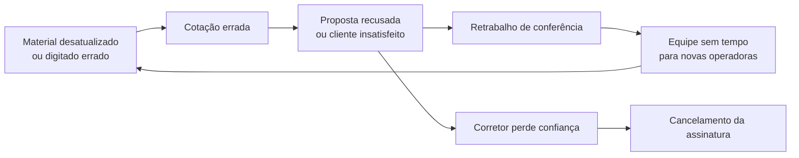
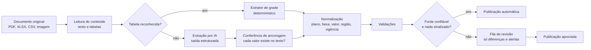
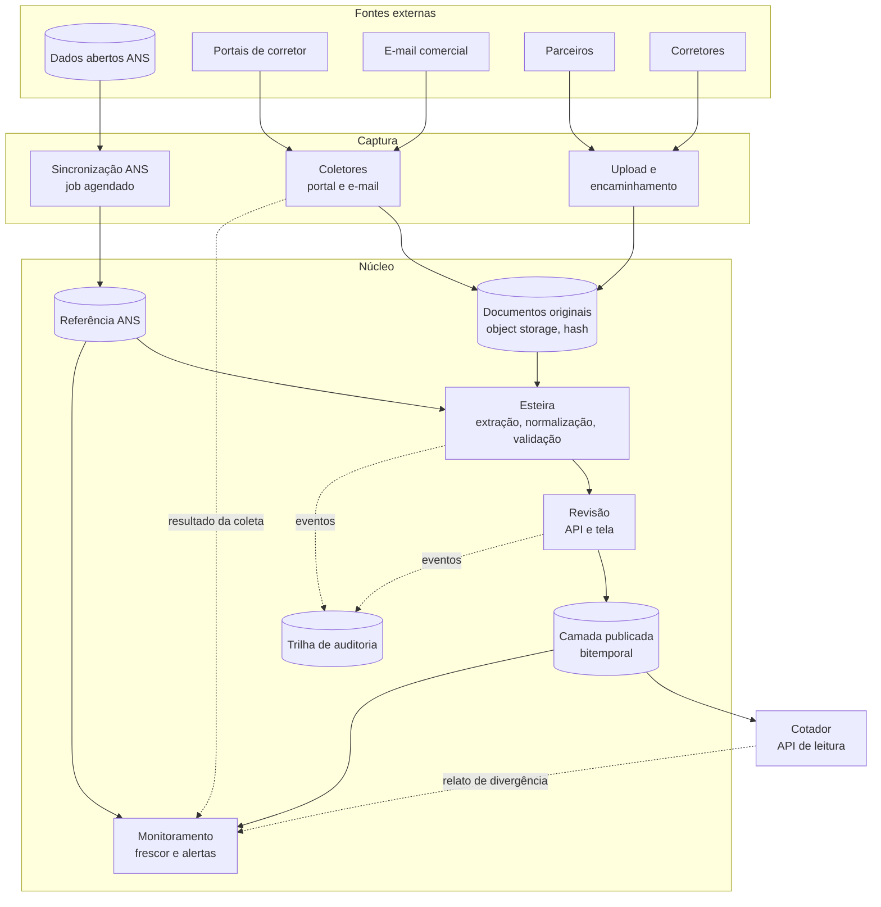
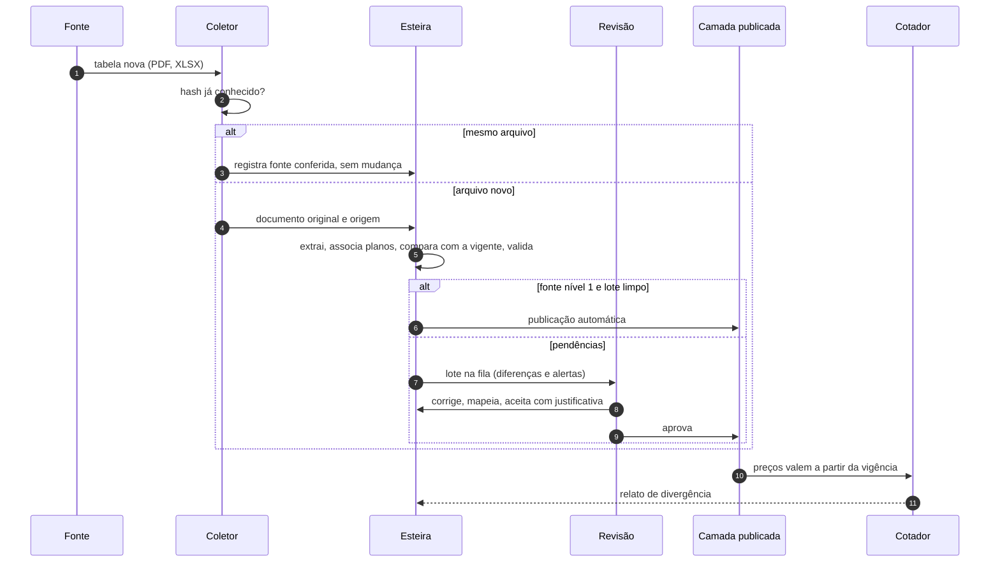

# Proposta: dados confiáveis e atualizados no Cotador de Planos de Saúde

Desafio técnico · obtenção, confiabilidade e atualização dos dados do cotador

---

## Resumo executivo

**O problema.** O cotador vale o quanto o corretor confia no preço que ele mostra. Hoje esse preço depende de materiais que chegam por canais fragmentados (alguns portais, e-mails, contatos pessoais) e de uma equipe que redigita cada valor, plano por plano. Quando algo muda numa operadora, nem sempre ficamos sabendo, e quando ficamos, o dado passa por um processo manual sujeito a erro de digitação, omissão e atraso. Além disso, não há registro sistemático de **de onde veio** cada valor, **desde quando vale** e **quando foi conferido** pela última vez.

**A tese.** Tratar cada informação do cotador como um **fato com origem, vigência e nível de confiança**, e fazer todo material passar por uma única esteira:

> **captura → extração → validação → revisão das diferenças → publicação versionada**

Três ideias sustentam a proposta:

1. **A ANS publica, em dados abertos, a espinha dorsal do catálogo para todas as operadoras**, inclusive as que não nos dão acesso: cadastro e situação de cada plano (atualização diária), faixa de preço registrada por plano e faixa etária na nota técnica (semanal), rede hospitalar por plano (mensal), entre outros. O preço comercial continua vindo das operadoras, mas cadastro, situação, rede hospitalar e limites de preço vêm de fonte oficial e automatizável. Com isso dá para validar o que a operadora manda e detectar mudanças mesmo onde não temos acesso.
2. **A equipe deixa de digitar e passa a revisar diferenças.** A máquina extrai a tabela, associa cada coluna a um plano do catálogo e compara com a versão vigente. A pessoa só olha o que mudou de forma suspeita ou o que uma regra sinalizou. Um reajuste uniforme de 9,8% em 50 valores vira um único fato a confirmar, não 50 digitações.
3. **Nada é sobrescrito.** Cada tabela publicada guarda o documento original, a célula de onde saiu cada valor, quem aprovou e a vigência. O sistema responde "qual era o preço válido em tal data" e também "o que o cotador mostrava em tal dia".

**Primeira entrega (6 semanas após o diagnóstico):** esteira de tabelas de preço para as operadoras com mais cotações, com referência ANS, regras de validação, tela de revisão por diferença, publicação com histórico e painel de atualização das fontes.

**Como saberemos que funcionou:** tempo entre o material chegar e o preço estar no cotador, horas de trabalho manual por tabela, correções após publicação, divergências relatadas por corretores e porcentagem de cotações servidas com preço confirmado no prazo. A Fase 0 mede a situação atual de cada métrica (seção 6.6).

**Protótipo funcional:** o repositório traz uma implementação desse recorte em Django, DRF, PostgreSQL e React, com dados de exemplo. Veja a seção 7 e o [README](../README.md) para executar.

---

## Sumário

1. [Entendimento do problema](#1-entendimento-do-problema)
2. [Obtenção dos dados](#2-obtenção-dos-dados)
3. [Redução do trabalho manual](#3-redução-do-trabalho-manual)
4. [Confiabilidade e atualização](#4-confiabilidade-e-atualização)
5. [Estrutura técnica](#5-estrutura-técnica)
6. [Plano de implementação](#6-plano-de-implementação)
7. [O protótipo](#7-o-protótipo)
8. [Anexos](#8-anexos)

---

## 1. Entendimento do problema

### 1.1 O que o cotador precisa saber

Uma cotação correta depende de várias dimensões ao mesmo tempo:

| Informação | Granularidade | Muda com que frequência | Exemplo de erro e efeito |
|---|---|---|---|
| **Preço** | plano × faixa etária (10 faixas da RN 63/2003) × região × tipo de contratação × faixa de vidas (PME) × entidade (adesão) × **vigência** | reajustes anuais, campanhas, novas tabelas comerciais | proposta recusada pela operadora, corretor perde a venda |
| **Situação comercial** | plano | quando a ANS suspende vendas, quando a operadora descontinua | vender plano que não pode ser comercializado |
| **Rede credenciada** | plano × prestador × município | inclusões e descredenciamentos ao longo do ano | cliente contrata achando que tem o hospital X |
| **Regras** (carência, coparticipação, reembolso) | plano ou produto, às vezes por campanha | menos frequente, mas em texto livre | expectativa errada do cliente e reclamação |

O preço é o dado mais visível e mais volátil, e também o mais estruturado (uma grade de faixas por planos). Por isso é o melhor ponto de partida.

### 1.2 Por que o dado diverge: causas-raiz

1. **Fontes fragmentadas e dependentes de pessoas.** Parte das operadoras tem portal do corretor, parte manda tabela por e-mail, parte só por contato pessoal ou por intermediários. Se a pessoa muda de função, o canal some.
2. **Não há sinal de mudança.** O problema não é só pegar a tabela nova, é **saber que ela existe**. Sem um registro de quando cada fonte foi conferida, uma tabela de 14 meses parece tão válida quanto a de ontem.
3. **Processo 100% manual e sem verificação sistemática.** Redigitar 50 valores por tabela gera erros previsíveis: dígitos trocados, vírgula no lugar errado, colunas trocadas, planos esquecidos.
4. **Sem origem nem vigência registradas.** Quando o corretor questiona um preço, não há como responder "veio do PDF X, página 1, aprovado em tal data, válido desde tal data".
5. **Identidade dos planos é ambígua.** O mesmo plano aparece como "Superior Apto.", "Superior QP" ou "Superior Apartamento" em materiais diferentes. A identidade estável existe (o número de registro do produto na ANS), mas não é usada como âncora.

### 1.3 Como o erro chega ao negócio

O ciclo se retroalimenta: o tempo gasto conferindo erros é o tempo que falta para ampliar cobertura e acompanhar mudanças.

### 1.4 O que o problema **não** é

- **Não é só "digitar mais rápido".** Automatizar a digitação sem validação apenas produz erros mais rápido.
- **Não é "fazer scraping de tudo".** Parte das fontes é restrita por contrato, termos de uso ou simplesmente não existe em formato acessível. A solução precisa funcionar bem com cobertura parcial, e ser **honesta** sobre o que não sabe.
- **Não é eliminar pessoas.** É mover o trabalho humano da digitação para o julgamento: aceitar um reajuste atípico, resolver uma divergência, falar com a operadora.

### 1.5 Premissas

- A maior parte do material comercial chega como **PDF com texto** ou **planilha**; uma parte menor como imagem, foto de WhatsApp ou texto corrido.
- O cotador atual tem uma base de planos e preços que pode ser carregada como "versão inicial" (seção 5.7).
- Existem dados de uso do cotador (cotações por operadora, plano e região) para priorizar onde investir primeiro.
- A equipe de dados continua existindo e passa a operar a fila de revisão.
- A stack do produto é Django, React e PostgreSQL (a mesma do protótipo), o que permite evoluir como módulo do sistema atual.

---

## 2. Obtenção dos dados

### 2.1 Mapa de fontes

Antes de falar de coleta, vale separar **que tipo de dado** vem de **qual tipo de fonte**:

| Tipo de dado | Fonte principal | Fonte de apoio / validação | Automação possível |
|---|---|---|---|
| Operadoras ativas, registro, modalidade | **ANS: CADOP** (diária) | — | total |
| Planos: registro, contratação, segmentação, acomodação, coparticipação (fator moderador), abrangência, **situação** (ativo, suspenso, cancelado) | **ANS: características dos produtos** (diária) | material da operadora | total |
| Faixa de preço registrada por plano e faixa etária (VCM da nota técnica, com mínimo e máximo de comercialização) | **ANS: NTRP, VCM por faixa etária** (semanal) | — | total |
| Preço comercial vigente | **operadora** (portal, e-mail, comunicado) | administradoras e assessorias, corretores | parcial, depende do canal |
| Rede hospitalar por plano (CNES, início e fim do vínculo, urgência/emergência) | **ANS: produtos e prestadores hospitalares** (mensal) | material da operadora | total |
| Rede não hospitalar (laboratórios, clínicas, médicos) | **operadora** (guia médico) | — | parcial |
| Área de comercialização | **ANS: área de comercialização (NTRP)** | material da operadora | total |
| Carências, coparticipação (percentuais e tetos), reembolso | **operadora** (manual, condições gerais) | limites legais (Lei 9.656/98) | extração por IA com revisão |
| Sinais de risco da operadora | **ANS: monitoramento da garantia de atendimento**, penalidades | — | total |

Os conjuntos da ANS foram verificados no portal de dados abertos ([dadosabertos.ans.gov.br/FTP/PDA](https://dadosabertos.ans.gov.br/FTP/PDA/)): todos são CSV com separador `;`, com dicionário de dados publicado e datas de atualização recentes. O dicionário da nota técnica define o **VCM mínimo** como o maior valor entre o VCM menos 30% e a despesa assistencial por exposto, e o **VCM máximo** como o VCM mais 30%. Isso dá um intervalo oficial, por plano e faixa etária, contra o qual conferir o preço comercial extraído de qualquer PDF.

> **Por que isso muda o problema.** A dificuldade de acesso passa a afetar só o *preço comercial* e as *regras em texto*. Cadastro, situação, rede hospitalar e limites de preço ficam disponíveis para **todas** as operadoras, de forma automatizada e com fonte oficial.

### 2.2 Canais de captura

| Canal | Como funciona | Automação | Confiança |
|---|---|---|---|
| **Dados abertos da ANS** | job agendado baixa os arquivos, importa só as operadoras do catálogo e registra cada sincronização | total | oficial (regulatória) |
| **Portal do corretor** (quando temos credencial) | coletor agendado acessa o portal, baixa as tabelas e compara o **hash** com o último arquivo | alta, onde os termos de uso permitem | oficial |
| **E-mail comercial dedicado** (ex.: tabelas@…) | cadastramos esse endereço com todos os contatos comerciais; anexos entram sozinhos na esteira | alta | oficial |
| **Encaminhamento pela equipe** (WhatsApp, e-mail pessoal) | qualquer pessoa encaminha o material para o e-mail dedicado ou faz upload; a origem é registrada | média | conforme o remetente |
| **Parceiros** (administradoras de benefícios, assessorias, corretoras master) | envio direto, planilha padrão ou API; uma administradora concentra tabelas de várias operadoras no coletivo por adesão | alta | parceiro |
| **Corretores** (usuários do cotador) | botão "reportar divergência" na cotação e envio de material recebido | baixa | comunidade (exige corroboração) |

Todo canal desemboca no mesmo lugar: um **documento original imutável**, identificado pelo hash SHA-256 do conteúdo. O mesmo arquivo recebido duas vezes não gera retrabalho, e o recebimento repetido ainda conta como evidência de que a fonte continua igual.

### 2.3 Catálogo de fontes

Cada fonte vira um registro com: operadora, canal, nível de confiança, **periodicidade esperada** de atualização, tolerância, contato responsável e se pode ter aprovação automática. A periodicidade esperada permite calcular o **frescor** de cada fonte:

- **Em dia:** conferida dentro da periodicidade.
- **Atenção:** passou da periodicidade, mas está dentro da tolerância.
- **Desatualizada:** passou da tolerância e gera alerta.

"Conferida" não significa só "chegou material novo". Também vale o **"sem mudança" confirmado**: o coletor encontrou o mesmo arquivo, ou o analista confirmou com o gerente comercial que a tabela segue válida. Isso separa o "não mudou" do "não sabemos".

### 2.4 Estratégia por nível de acesso

| Nível | Situação | Estratégia |
|---|---|---|
| **A: automatizável** | portal com credencial, feed ou e-mail oficial | coletor agendado; aprovação automática para lotes limpos, depois de um histórico de acertos |
| **B: canal manual** | material chega por e-mail ou download manual | e-mail dedicado e encaminhamento; extração automática e revisão por diferença |
| **C: depende de contato** | só via gerente comercial ou intermediário | registrar o contato no catálogo, combinar uma rotina (ex.: mensal) e pedir confirmação ativa quando a fonte fica "em atenção" |
| **D: sem acesso** | nenhum canal estável | parceiros e corretores como fonte, sinais da ANS como gatilho para buscar o material, e transparência no cotador |

### 2.5 Fontes restritas ou indisponíveis

1. **Priorizar pelo uso.** Ordenar operadoras, planos e regiões pelo volume de cotações. É razoável esperar uma distribuição concentrada, com poucas operadoras respondendo pela maior parte das cotações; a Fase 0 mede isso. A métrica que importa é a **cobertura ponderada por uso**, não o número de operadoras.
2. **Parcerias com proposta de valor clara.** Para a operadora, estar correta no cotador é canal de venda e reduz propostas recusadas. Oferecer a ela (e a administradoras e assessorias) um portal ou planilha padrão de envio, mais visibilidade de demanda (quais planos são mais cotados) em troca de envio direto e antecipado das tabelas.
3. **Usar sinais públicos como gatilho.** Nova nota técnica registrada para um plano, mudança de situação na ANS, saída de hospital da rede ou pedido de alteração de rede: cada evento vira um alerta para **buscar ativamente** o material daquela operadora, mesmo sem acesso direto.
4. **Corretores como sensores.** O relato de divergência e o envio de material entram na mesma esteira, com confiança "comunidade". Não publicam sozinhos: exigem corroboração (outro relato, outra fonte) ou conferência humana. Pode haver incentivo, como crédito na assinatura para relatos confirmados.
5. **Transparência no cotador.** Em vez de esconder a incerteza, mostrar ao corretor um selo como "tabela vigente desde 01/05 · fonte oficial · conferida há 2 dias" ou "a confirmar". O corretor decide melhor e a confiança no produto aumenta, porque o produto não finge saber o que não sabe.
6. **Política de expiração definida com o negócio.** Por exemplo: preço sem confirmação há mais de N dias aparece com aviso; acima de M dias sai da comparação automática. É uma decisão de produto, e a infraestrutura de frescor torna ela aplicável.

### 2.6 Como acompanhar mudanças

- **Hash do documento:** detecta material novo e ignora reenvios.
- **Coleta periódica com resultado registrado:** novo material, sem mudança ou falha. Falhas viram alerta.
- **Calendário de reajustes:** reajustes de planos individuais seguem o ciclo anual da ANS, e PMEs têm agrupamento de contratos. A periodicidade de cada fonte pode aprender com o próprio histórico de chegadas.
- **Revalidação contínua:** quando a referência da ANS muda (semanalmente, no caso do VCM), as tabelas vigentes são revalidadas. Um preço que ficou fora da faixa registrada vira alerta, mesmo sem material novo.

### 2.7 Acessos e cuidados

- **Credenciais de portais** em cofre de segredos, com acesso de menor privilégio, rotação e registro de uso. Nunca em planilha ou código.
- **Termos de uso:** validar com o jurídico, portal a portal, se a coleta automatizada é permitida. Quando não for, usar coleta assistida (a pessoa baixa e o sistema processa) ou buscar canal oficial.
- **LGPD:** materiais comerciais em geral não têm dados pessoais, mas propostas e e-mails podem ter. Classificar na entrada, descartar ou mascarar o que não for necessário e definir política de retenção.

---

## 3. Redução do trabalho manual

### 3.1 A esteira

### 3.2 Extração em camadas

1. **Extrator genérico de grade (determinístico).** Tabelas de preço são grades "faixa etária × plano". Em vez de escrever um parser por operadora, o extrator **procura o eixo que contém as 10 faixas etárias** (em qualquer grafia: "00 a 18 anos", "0-18", "até 18", "59 ou mais", "59+") e lê os rótulos de plano no eixo oposto, inclusive cabeçalhos em duas linhas com células mescladas ("Essencial" sobre "Enfermaria | Apartamento"). Cobre faixas nas linhas, faixas nas colunas e o formato longo (plano; faixa; valor) de exportações. Custo zero por documento, comportamento previsível e testável.
2. **Perfis por operadora, só quando necessário.** Para peculiaridades (páginas a ignorar, uma tabela por região no mesmo PDF), um perfil declarativo ajusta o extrator genérico, sem código novo por operadora.
3. **IA para a cauda longa.** Comunicados em texto corrido, fotos de tabela e layouts inéditos vão para um modelo de linguagem com **saída estruturada por JSON Schema**. O modelo não "calcula" nada: ele **localiza** cada preço e copia o texto exato do documento. O valor numérico é interpretado pelo nosso código, e uma regra confere que cada texto devolvido aparece literalmente no documento. Se não aparecer, é erro bloqueante.
4. **Pessoa como última camada,** e só para o que as anteriores não resolveram.

Por documento de 2 a 5 páginas, o custo de IA fica na ordem de alguns centavos de dólar (estimativa com preços públicos de API), irrelevante perto do custo da hora de digitação. O maior risco não é custo, e sim valor errado com aparência de certo. Por isso a ancoragem e as validações são obrigatórias para tudo que vem de IA.

### 3.3 Normalização e identidade

- **Plano:** o número de registro do produto na ANS é a âncora estável. Nomes de material ("Premium Apto.", "Superior QP", "Essencial c/ copart.") são normalizados com o vocabulário do mercado (QC = enfermaria, QP = apartamento, Apto, Enf, c/ e s/). A associação é feita em três níveis: nome conhecido; similaridade com confirmação obrigatória, mas nunca entre planos de números diferentes ("Horizonte 300" não vira "Horizonte 200") nem entre acomodações diferentes; e plano não identificado, que vira erro com sugestões. **Quando a pessoa mapeia um rótulo, o sistema aprende o apelido** e a próxima tabela já vem associada.
- **Faixa etária:** convertida para as 10 faixas da RN 63/2003.
- **Valor:** interpretado no padrão brasileiro ("R$ 1.234,56"), em formato de exportação ("1234.56") e em células numéricas de planilha, sempre guardando o texto original ao lado.
- **Vigência e região:** detectadas no texto ("Vigência: 01/11/2026", "a partir de…", "Região: …"); a pessoa só informa quando não estão no documento.

### 3.4 Revisão por diferença

A tela de revisão mostra a tabela nova **lado a lado com a vigente**: cada célula traz o valor novo, o anterior e a variação, e o lugar de onde saiu no documento (página, célula, rótulos de linha e coluna). A pessoa não confere 50 valores. Ela confere:

- o reajuste mediano ("+9,80% em todas as faixas"), que vale como um fato só;
- as **exceções**: a faixa que subiu 22% quando todas subiram 9,8% (provável dígito trocado), o valor 10 vezes maior que o anterior (vírgula no lugar errado), o plano que sumiu do material, o nome de plano novo.

### 3.5 Quando a pessoa entra

| Situação | Por quê | O que a pessoa faz |
|---|---|---|
| Primeira tabela de uma operadora ou layout | não há histórico para comparar | confere tudo uma vez; os apelidos ficam aprendidos |
| Erro bloqueante (RN 63, valor ilegível, faixa faltando, plano não identificado, vigência ausente) | dado estruturalmente inválido ou proibido | corrige o valor, mapeia o plano ou rejeita o lote |
| Alerta (reajuste fora do padrão, valor fora da faixa registrada na ANS, plano ausente, similaridade) | suspeito, mas pode ser legítimo | aceita com justificativa (fica na trilha de auditoria) ou corrige |
| Extração por IA | risco de alucinação | conferência obrigatória enquanto a taxa de acerto não justificar automação |
| Divergência entre fontes | só um julgamento resolve | decide a versão correta e registra o motivo |
| Amostragem de lotes publicados automaticamente | medir a qualidade da automação | audita uma amostra (ex.: 5%) |

### 3.6 Automação progressiva

| Nível | Critério | Comportamento |
|---|---|---|
| **0** | padrão de toda fonte nova | toda tabela passa por revisão |
| **1** | fonte oficial, extrator determinístico, nenhuma tabela corrigida nos últimos N ciclos | **publicação automática** quando o lote não tem erro nem alerta; amostragem posterior |
| **2** | feed estruturado ou API de parceiro com contrato de dados | publicação automática com auditoria periódica |
| **Rebaixamento** | qualquer correção após publicação, falha de coleta ou mudança de layout | a fonte volta ao nível anterior até recuperar o histórico |

Os critérios são dados (no catálogo de fontes), não código: a operação ajusta conforme mede.

### 3.7 Ordem de grandeza do ganho (hipótese a medir na Fase 0)

Suponha uma tabela PME com 5 planos e 10 faixas (50 valores). Digitar e conferir leva algo como 15 a 30 minutos. Na esteira, o caso comum (reajuste uniforme, sem exceções) leva de 1 a 3 minutos de revisão, e o caso com problemas leva alguns minutos para corrigir **exatamente** as células sinalizadas. Em fontes de nível 1 o tempo humano tende a zero. Esses números são hipóteses: a Fase 0 mede o tempo atual por tabela e o piloto mede o tempo novo (seção 6.6).

---

## 4. Confiabilidade e atualização

### 4.1 Validações em camadas

Cada regra tem um código, uma severidade e uma mensagem que explica o problema em português, com os valores envolvidos. O catálogo completo está no Anexo B. Os grupos:

| Grupo | Exemplos | Base |
|---|---|---|
| **Estrutura** | faixa faltando, valor ilegível, valor não positivo, mais de uma tabela para os mesmos planos | integridade |
| **Regulatórias** | (I) última faixa no máximo 6 vezes a primeira; (II) variação acumulada entre a 7ª e a 10ª faixa não pode superar a variação entre a 1ª e a 7ª; (III) nenhuma variação negativa entre faixas | RN 63/2003, art. 3º (inciso III incluído pela RN 254/2011); cálculo multiplicativo conforme o Tema 952 do STJ |
| **Referência ANS** | plano suspenso ou cancelado; preço fora do intervalo mínimo e máximo da nota técnica; atributo divergente do registro (acomodação, coparticipação, abrangência) | dados abertos da ANS |
| **Consistência** | reajuste não uniforme entre faixas; variação grande contra a tabela vigente; erro de casa decimal (fator ~10 ou ~1/10); enfermaria mais cara que apartamento da mesma linha (colunas trocadas); plano com coparticipação mais caro que o equivalente sem; plano vigente que sumiu do material | heurísticas do domínio |
| **Vigência** | data ausente; mesma data de uma versão publicada (correção); data anterior à vigente (inserção retroativa); captura atrasada (o cotador mostrou a tabela antiga por N dias); tabela agendada | regras do histórico |
| **IA** | extração por IA (exige conferência); valor que não aparece no texto do documento | ancoragem |
| **Regras de produto** (fase 3) | carência acima do máximo legal: 24 horas para urgência e emergência, 300 dias para parto a termo, 180 dias nos demais casos; CPT acima de 24 meses | Lei 9.656/98, arts. 11 e 12 |

As camadas se complementam. No protótipo, um dígito trocado em "R$ 3.209,40" que vira "R$ 3.902,40" escapa da faixa da ANS (que é larga), mas viola os dois incisos da RN 63. Um "R$ 878,13" que deveria ser "R$ 787,13" não viola nenhuma norma, mas aparece como reajuste de 22,5% numa tabela em que todas as outras faixas subiram 9,8%.

### 4.2 Severidade e política de publicação

- **Erro:** bloqueia a publicação. Precisa ser corrigido (valor, mapeamento, vigência) ou o plano precisa ser excluído do lote.
- **Alerta:** bloqueia até ser **aceito com justificativa**. A justificativa fica registrada, e se o dado mudar depois o alerta reabre.
- **Informação:** contexto para quem revisa (tabela agendada, plano sem histórico, atraso de captura).

Os limiares das heurísticas (25% de variação, 1 ponto percentual de tolerância no reajuste) são configuráveis. A taxa de aceite de cada regra deve ser medida: uma regra que só gera alerta aceito está mal calibrada e cria fadiga de revisão.

### 4.3 Divergências entre fontes

1. **Hierarquia de confiança:** oficial (operadora) acima de parceiro, e parceiro acima de comunidade.
2. **Mesma vigência, valores diferentes:** é uma divergência. Se a fonte nova é mais confiável, vira **correção** (a versão anterior é substituída e preservada no histórico); se é igual ou menos confiável, vai para decisão humana com contato com a operadora.
3. **Registro da decisão:** quem decidiu, com base em quê, e qual documento.
4. **Impacto:** como o histórico guarda o que o cotador mostrava em cada momento, é possível identificar o período em que o preço errado esteve no ar e, numa fase posterior, avisar os corretores que cotaram nesse intervalo.

### 4.4 Origem, vigência e histórico

**Modelo bitemporal.** Cada versão de tabela publicada tem dois eixos de tempo:

- **Vigência:** quando o preço vale no mundo real (ex.: de 01/11/2026 em diante).
- **Registro:** quando o sistema passou a considerar essa versão, e quando deixou de considerar.

Nada é editado no lugar. Publicar uma tabela nova com vigência a partir de 01/11:

| Antes da publicação | Depois da publicação |
|---|---|
| V1: vigência 01/05 → ∞, registrada em 25/04 | V1: vigência 01/05 → ∞, **substituída em 20/10** (preservada) |
| | V1′: vigência 01/05 → 31/10, registrada em 20/10 (recorte de V1, mesma origem) |
| | V2: vigência 01/11 → ∞, registrada em 20/10 |

Com isso o sistema responde perguntas que hoje não têm resposta:

- "Qual o preço válido em 15/12?" Resposta: V2.
- "O que o cotador mostrava em 18/10 para uma cotação em 15/12?" Resposta: V1, porque a tabela nova ainda não tinha sido publicada. Isso serve para auditoria e para atender reclamações.
- "Vai mudar algum preço?" Sim, a partir de 01/11, e o cotador já avisa o corretor.

Além disso:

- **Documento original imutável**, endereçado pelo hash, sempre disponível a partir de qualquer preço.
- **Procedência por valor:** página ou planilha, célula, rótulos de linha e coluna, texto original e se houve correção humana.
- **Trilha de auditoria** só de inserção: recebimento, extração, correção, mapeamento, aceite de alerta, publicação, rejeição, confirmação de fonte, sincronização com a ANS.
- **Garantia no banco de dados:** uma restrição de exclusão no PostgreSQL impede duas versões vigentes sobrepostas para o mesmo plano e região, mesmo que algum código tente gravar errado.

### 4.5 Como identificar falhas e dados desatualizados

| Sinal | Como é detectado | Ação |
|---|---|---|
| Fonte sem novidade além do prazo | frescor por periodicidade esperada | alerta e pedido ativo à operadora |
| Coleta falhou (portal fora do ar, login inválido) | resultado da verificação registrado | alerta; abre e fecha sozinho conforme o resultado da próxima coleta |
| Tabela muito antiga (ex.: mais de 12 meses) | idade da versão vigente | alerta de provável reajuste não capturado |
| Plano suspenso ou cancelado na ANS ainda ativo no cotador | sincronização diária | alerta crítico e retirada do cotador com um clique |
| Preço vigente saiu da faixa da nota técnica | revalidação após cada sincronização semanal | alerta |
| Mudança de layout | aumento de lotes com falha ou de correções numa fonte | alerta e rebaixamento do nível de automação |
| Corretor relatou divergência | botão na cotação | alerta com o relato |
| Atraso de captura | diferença entre vigência e publicação | métrica de operação |

Os alertas são **idempotentes**: cada verificação atualiza o alerta existente em vez de duplicá-lo, e o alerta se resolve sozinho quando a condição deixa de existir.

### 4.6 Transparência para o corretor

Cada preço cotado leva:

- desde quando vale;
- de que tipo de fonte veio (oficial, parceiro, comunidade);
- quando a fonte foi conferida pela última vez;
- quem aprovou, ou se foi publicação automática;
- se há **nova tabela agendada** ("a partir de 01/11: R$ 577,55, +9,8%"), informação útil para o corretor fechar antes do reajuste;
- situação do plano na ANS, quando não estiver ativo.

---

## 5. Estrutura técnica

### 5.1 Componentes

### 5.2 Fluxo de uma tabela

### 5.3 Armazenamento

| Camada | Conteúdo | Tecnologia | Por quê |
|---|---|---|---|
| **Original** | arquivos recebidos, imutáveis | object storage (S3 ou compatível), chave = hash | barato, versionável, auditável |
| **Extração** (staging) | planos e valores extraídos, correções, procedência, pendências | PostgreSQL, com JSONB para a procedência | flexível por layout e consultável |
| **Publicada** | versões de tabela com vigência (`daterange`) e registro (`recorded_at`, `superseded_at`) | PostgreSQL com **restrição de exclusão** (`btree_gist`) contra sobreposição | integridade garantida pelo banco, não só pelo código |
| **Referência** | espelho dos conjuntos da ANS (operadoras, planos, faixas de VCM) | PostgreSQL, carga em lote com upsert | consulta rápida nas validações |
| **Auditoria** | eventos só de inserção | PostgreSQL (particionável por data) | rastreabilidade |

O cotador lê da camada publicada com uma consulta simples ("versão vigente em tal data para tal plano e região") ou por uma view materializada, caso o volume de leitura peça.

### 5.4 Escolhas técnicas

| Decisão | Por quê | Alternativa considerada | Quando revisitar |
|---|---|---|---|
| Monólito modular em **Django + DRF**, separado por domínio (catálogo, fontes, ingestão, qualidade, preços, monitoramento) | mesma stack do produto; ORM, migrations e admin maduros; time pequeno entrega mais rápido | microserviços | quando houver times independentes ou cargas muito diferentes |
| **PostgreSQL** com `daterange` e restrição de exclusão para o histórico | integridade temporal no banco; consultas simples | tabelas de histórico por trigger; event sourcing completo | se a auditoria exigir retenção longa: particionar |
| Regras de validação como **funções puras** sobre um retrato do lote | testáveis sem banco; fáceis de ler e calibrar; uma regra nova é uma função | motor de regras genérico configurável | quando a operação quiser criar regras sem deploy |
| **Extrator genérico de grade** antes de perfis por operadora | o custo de uma operadora nova tende a zero | um parser por operadora | quando surgirem layouts que o genérico não cobre |
| **IA só como fallback**, com saída estruturada e ancoragem | cobre a cauda longa (texto corrido, fotos) com risco controlado | IA para tudo; OCR com regex por operadora | conforme a taxa de acerto medida |
| **Fila de tarefas** (Celery + Redis, ou fila sobre Postgres) | coleta, OCR e IA são lentos e precisam de retentativa e agendamento | cron e processamento síncrono | o protótipo processa de forma síncrona por simplicidade |
| **Coletores com navegador headless** (Playwright) para portais e IMAP/Graph para e-mail | portais de corretor raramente têm API | coleta manual | quando a operadora oferecer feed |
| **Frontend React** para a revisão | grade interativa, atalhos e contexto ao lado; o admin do Django serve para o cadastro | só o admin do Django | — |

### 5.5 Escala

- **Volume de dados não é o gargalo.** Numa estimativa ilustrativa de 50 operadoras, 15 planos, 5 regiões e 2 tipos de contratação, são 7.500 tabelas e 75 mil valores vigentes. Mesmo com anos de histórico bitemporal são poucos milhões de linhas: um único PostgreSQL bem indexado atende, com particionamento por data como reserva.
- **O gargalo é a atenção humana.** Por isso o desenho otimiza minutos de revisão por tabela: revisão por diferença, agrupamento de alertas (um reajuste uniforme gera um aviso por plano, não um por faixa), automação progressiva e priorização por uso.
- **Custo marginal de uma operadora nova:** cadastrar fontes e planos (o cadastro pode vir da ANS) e revisar a primeira tabela. Sem código novo no caso comum.
- **Federações e intermediários:** algumas marcas são, na prática, várias operadoras (cooperativas singulares, cada uma com registro e tabelas próprias). O modelo trata cada registro ANS como uma operadora e agrupa por marca na apresentação. Administradoras de benefícios multiplicam a cobertura do coletivo por adesão com um único canal.
- **Processamento:** coleta, extração e IA rodam em workers assíncronos que escalam horizontalmente; a API de leitura do cotador é independente da esteira.

### 5.6 Segurança, LGPD e operação

- **Papéis:** analista (recebe, corrige, mapeia, aceita alertas) e revisor (publica, rejeita, retira plano do cotador). Toda ação fica na trilha de auditoria.
- **Segredos** (credenciais de portais, chave de IA) em cofre, nunca em código; configuração por ambiente.
- **Dados pessoais:** não enviar a provedores de IA documentos com dados pessoais; classificar e mascarar na entrada.
- **Observabilidade:** métricas da esteira (lotes por status, tempo em fila, taxa de falha de extração por fonte), alertas operacionais e backups com teste de restauração.

### 5.7 Integração com o cotador atual

1. **Carga inicial:** a base atual do cotador entra como "versão 0" de cada tabela, com origem "legado". Assim o histórico começa completo e a primeira tabela nova já tem com o que comparar.
2. **Leitura:** o cotador passa a ler preços da camada publicada (consulta por data), primeiro em paralelo com a base atual para comparar resultados e depois como fonte principal.
3. **Publicação agendada sem esforço:** uma tabela aprovada hoje com vigência em 01/11 já está publicada; ela só passa a valer na data. Ninguém precisa "virar a tabela" à meia-noite.

---

## 6. Plano de implementação

### 6.1 Fases

| Fase | Duração | Entrega | Critério de pronto |
|---|---|---|---|
| **0. Diagnóstico** | 2 semanas | inventário de operadoras, fontes, acessos e contatos; medição do processo atual (tempo por tabela, erros encontrados, atraso médio); ranking de operadoras por volume de cotações; carga do catálogo a partir da ANS | baseline das métricas da seção 6.6 publicado |
| **1. MVP: esteira de tabelas de preço** | 6 semanas | upload e e-mail dedicado; extrator de grade; validações (estrutura, RN 63, ANS, consistência, vigência); tela de revisão por diferença; publicação bitemporal; leitura pelo cotador em paralelo; painel de frescor | 5 a 10 operadoras de maior volume passando 100% pela esteira |
| **2. Captura e frescor** | 6 semanas | coletores de portal onde permitido; alertas de fonte atrasada e falha; relato de divergência no cotador; selo de origem e atualização para o corretor; nível 1 de automação | metade das tabelas das operadoras do MVP chegando sem ação humana na captura |
| **3. Regras, rede e IA** | 8 semanas | extração por IA (comunicados, manuais) com ancoragem; carências e coparticipação estruturadas; rede hospitalar via ANS e CNES; divergência entre fontes | regras e rede das operadoras do MVP no mesmo padrão de origem e vigência |
| **4. Escala** | contínua | portal ou planilha padrão para parceiros; mais operadoras por ordem de volume; calibração de regras pela taxa de aceite; amostragem de qualidade | cobertura ponderada por uso acima da meta |

### 6.2 Primeira entrega

Para 5 a 10 operadoras de maior volume:

- recepção por upload e e-mail dedicado, com documento original e hash;
- extrator de grade e normalização (planos, faixas, valores, vigência, região);
- validações de estrutura, RN 63, referência ANS (situação e faixa de VCM), consistência e vigência;
- fila e tela de revisão por diferença, com procedência por célula, correção, mapeamento, aceite com justificativa, publicação e rejeição;
- publicação bitemporal e leitura pelo cotador em paralelo com a base atual;
- painel de frescor por fonte, com alertas de fonte atrasada, tabela antiga e plano suspenso na ANS.

**Por que começar por preço:** é o dado mais visível para o corretor, o mais estruturado (dá para automatizar bem) e o mais fácil de medir. O protótipo deste repositório é exatamente esse recorte.

### 6.3 Riscos e mitigação

| Risco | Impacto | Mitigação |
|---|---|---|
| Operadoras não aceitam enviar tabelas ou restringem portais | médio | priorizar por volume; múltiplos canais; parceiros; sinais da ANS; transparência no cotador |
| Termos de uso proíbem coleta automatizada | alto (jurídico) | validar portal a portal; coleta assistida; buscar canal oficial |
| Mudança de layout quebra a extração | médio | extrator genérico, monitor de falha por fonte, IA de fallback, rebaixamento automático |
| IA devolve valor errado com aparência de certo | alto | ancoragem no texto, validações, revisão obrigatória no início, amostragem |
| Regras geram ruído e cansam quem revisa | médio | limiares configuráveis, agrupamento, medição da taxa de aceite por regra |
| Identidade de planos inconsistente | médio | registro ANS como âncora, apelidos aprendidos, revisão do catálogo na Fase 0 |
| Limites dos dados da ANS (VCM só para planos com nota técnica; rede só hospitalar) | baixo | usar como alerta, não como bloqueio; mostrar a data de atualização |
| Dependência de contatos pessoais | alto | contatos no catálogo de fontes, rotinas combinadas, mais de um contato por operadora |
| Vazamento de credenciais de portais | alto | cofre, menor privilégio, rotação, auditoria de uso |
| Baixa adesão da equipe | médio | envolver a equipe desde a Fase 0; a tela precisa ser mais rápida que o processo atual, e isso é medido |

### 6.4 Limitações conhecidas

- A chave de preço completa inclui faixa de vidas (PME) e entidade (adesão); o protótipo trata região e contratação, e o modelo se estende somando dimensões à chave.
- Rede não hospitalar (laboratórios, clínicas, médicos) não está nos dados abertos da ANS e depende do guia da operadora.
- O VCM da nota técnica é um **intervalo de referência**, não o preço comercial, e não cobre todos os produtos.
- Regras em texto livre (carência reduzida em campanhas, coparticipação por procedimento) sempre terão algum grau de interpretação humana.
- Nenhuma automação substitui o relacionamento com as operadoras; a proposta torna esse relacionamento mais eficiente e mensurável.

### 6.5 Dependências

- **Dados de uso do cotador** para priorizar (cotações por operadora, plano e região).
- **Inventário de acessos e contatos** atuais.
- **Decisões de produto:** política de expiração (o que mostrar quando o dado está velho) e o selo para o corretor.
- **Jurídico:** termos de uso de portais e contratos com parceiros.
- **Equipe de dados** dedicada à fila de revisão e à calibração das regras.
- **Infraestrutura:** object storage, fila, cofre de segredos e chave de API de IA (custo baixo).

### 6.6 Como verificar o resultado

| Métrica | Como medir | Meta do MVP | Meta em 6 meses |
|---|---|---|---|
| **Lead time** (material recebido → publicado), mediana | timestamps do documento e da publicação | menos de 1 dia útil | menos de 4 horas nas fontes automatizadas |
| **Esforço manual por tabela** | tempo entre abrir e decidir o lote, mais as ações registradas | -60% sobre o baseline | -80% |
| **Correções após publicação** | versões que corrigem a mesma vigência ÷ versões publicadas | < 2% | < 0,5% |
| **Divergências relatadas** por 1.000 cotações | relatos de corretores | medir | -50% sobre o MVP |
| **Cotações com preço confirmado no prazo** | cotações cuja fonte estava em dia ÷ total | > 90% | > 97% |
| **Atraso de captura** | dias entre a vigência e a publicação | mediana ≤ 0 (publicar antes de valer) | ≤ 0 |
| **Cobertura ponderada por uso** | cotações cobertas pela esteira ÷ total | operadoras do MVP | > 80% das cotações |
| **Automação** | lotes publicados sem intervenção ÷ total | — | > 50% |

Acompanhamento semanal no painel durante o MVP e mensal depois. Um resultado bom no painel deve aparecer também no negócio (retenção e satisfação dos corretores).

---

## 7. O protótipo

### 7.1 Recorte e motivo

O protótipo implementa a **primeira entrega** da seção 6.2 de ponta a ponta, com dados de exemplo: é a parte central da proposta (a esteira e a confiabilidade) e a que mais reduz trabalho manual. Instruções de execução e o roteiro de demonstração estão no [README](../README.md).

### 7.2 O que foi implementado

| Proposta | No protótipo |
|---|---|
| Documento original imutável e deduplicado (2.2) | armazenamento por hash SHA-256; reenvio reconhecido e registrado como fonte conferida (`backend/apps/ingestion`) |
| Coletores e canais (2.2) | coletor genérico usado pelo upload, pelo comando `collect_inbox` (pasta que simula o e-mail) e pelo painel de demonstração; operadora identificada pelo registro ANS impresso no material |
| Catálogo de fontes e frescor (2.3) | periodicidade e tolerância por fonte; "conferido sem mudança"; falhas de coleta (`backend/apps/sources`) |
| Dados abertos da ANS (2.1) | importadores para os formatos **reais** de CADOP, características dos produtos e VCM por faixa (CSV e zip, com filtro por operadora); verificados contra os arquivos reais da ANS (`backend/apps/ans_reference`) |
| Extração em camadas (3.2) | extrator genérico de grade (faixas em linhas, em colunas e formato longo; cabeçalho mesclado em duas linhas) para PDF, XLSX e CSV; extração por IA opcional com saída estruturada e ancoragem (`backend/apps/ingestion/extraction`) |
| Normalização e identidade (3.3) | vocabulário de mercado, similaridade com proteção contra número e acomodação diferentes, apelidos aprendidos na revisão (`backend/apps/catalog`) |
| Validações (4.1) | 25 regras puras e testadas: estrutura, RN 63 (I, II e III), situação e faixa da ANS, reajuste não uniforme, variação grande, casa decimal, ordem de preços, plano ausente, vigência e ancoragem de IA (`backend/apps/quality/rules`) |
| Revisão por diferença (3.4) | tela com grade nova × vigente, origem por célula, correção, mapeamento, exclusão, aceite com justificativa, aprovação e rejeição com papéis distintos |
| Automação nível 1 (3.6) | publicação automática para fonte marcada como confiável **e** lote sem erro ou alerta |
| Histórico bitemporal (4.4) | versões com `daterange` + `recorded_at` e `superseded_at`; recortes preservam a origem; restrição de exclusão no PostgreSQL; consulta "como o cotador estava em" |
| Monitoramento (4.5) | alertas idempotentes de fonte atrasada, falha de coleta, tabela antiga e plano suspenso na ANS; relato de divergência do corretor; painel |
| Transparência ao corretor (4.6) | simulador de cotação com origem, frescor, situação ANS e próxima tabela agendada |
| Trilha de auditoria (4.4) | eventos só de inserção para cada ação, exibidos no lote e no painel |

### 7.3 O que foi simulado

- **Operadoras, planos, registros ANS e valores são de exemplo** e não correspondem a entidades reais (Vida Plena Saúde, Horizonte Saúde Seguros e CoopSaúde Litoral; registros na faixa 900xxx). Os materiais (PDF, XLSX e comunicado em texto) são gerados com datas relativas ao dia da execução, para que sempre exista histórico, tabela vigente e reajuste agendado.
- **Dados da ANS:** o seed gera arquivos de exemplo **no formato real** e os importa com o mesmo importador que funciona com os arquivos oficiais.
- **Coletores:** o portal e o e-mail são simulados pelo painel de demonstração e pelo comando `collect_inbox`; não há login em portais reais.
- **Extração por IA:** implementada e testada com respostas gravadas. Só chama a API se `ANTHROPIC_API_KEY` estiver definida; sem chave, o comunicado em texto corrido falha de forma explícita e fica para tratamento manual.
- **Processamento síncrono:** em produção seriam tarefas em fila (seção 5.4).
- **Fora do recorte:** rede credenciada, carências e coparticipação, OCR de imagens, faixa de vidas e entidade na chave de preço, notificação de corretores impactados.

### 7.4 Qualidade

- Backend: 215 testes automatizados (pytest, contra PostgreSQL real), cobrindo regras, extração, importadores da ANS, publicação bitemporal (inclusive a restrição do banco), revisão, monitoramento, API (permissões, erros e semântica de PATCH) e o cenário completo de demonstração. Nenhum teste chama serviço externo.
- Frontend: 32 testes (Vitest e Testing Library) de formatação, i18n, modelo de revisão, grade de preços (inclusive o nome acessível de cada célula), diálogo, cabeçalho e filtro da fila; lint e checagem de tipos.
- Interface: design system com tokens e contraste verificado; varredura automática de acessibilidade (WCAG 2.2 AA) sem violações em 16 telas e estados, mais checagem manual de teclado e foco. Detalhes em [DESIGN-SYSTEM.md](DESIGN-SYSTEM.md).
- CI no GitHub Actions com lint, formatação, migrações sincronizadas, testes e build.

---

## 8. Anexos

### A. Glossário

| Termo | Significado |
|---|---|
| **ANS** | Agência Nacional de Saúde Suplementar |
| **CADOP** | cadastro de operadoras ativas da ANS |
| **NTRP** | Nota Técnica de Registro de Produto, documento atuarial registrado na ANS |
| **VCM** | Valor Comercial da Mensalidade informado na NTRP, por faixa etária |
| **CNES** | Cadastro Nacional de Estabelecimentos de Saúde |
| **RN 63/2003** | resolução que define as 10 faixas etárias e os limites de variação entre elas |
| **Vigência** | período em que um preço vale no mundo real |
| **Bitemporal** | modelo que guarda vigência e registro, ou seja, quando vale e quando o sistema soube |
| **Lote** | um documento recebido, extraído e validado, aguardando decisão |
| **Frescor** | quão recentemente uma fonte foi conferida em relação à periodicidade esperada |
| **Ancoragem** | conferência de que um valor extraído por IA aparece literalmente no documento |

### B. Catálogo de regras do protótipo

| Código | Severidade | O que verifica |
|---|---|---|
| `validity.missing_effective_date` | erro | vigência não encontrada no documento |
| `catalog.unmatched_plan` | erro | rótulo sem plano correspondente no catálogo (com sugestões) |
| `catalog.similarity_match` | alerta | plano associado por similaridade, confirmação necessária |
| `structure.missing_band` | erro | faixa etária ausente para o plano |
| `structure.unparseable_value` | erro | valor que não pôde ser interpretado |
| `structure.non_positive_value` | erro | valor zero ou negativo |
| `structure.conflicting_tables` | alerta | mais de uma tabela para os mesmos planos no documento |
| `extraction.value_not_anchored` | erro | valor de IA que não existe no texto do documento |
| `extraction.ai_extracted` | alerta | lote extraído por IA (conferência obrigatória) |
| `ans.plan_not_active` | erro | plano suspenso, cancelado ou transferido na ANS |
| `rn63.last_band_ratio` | erro | 59+ maior que 6 vezes a faixa 0–18 |
| `rn63.accumulated_variation` | erro | variação 7ª→10ª maior que a 1ª→7ª |
| `rn63.negative_variation` | erro | faixa mais velha mais barata que a anterior |
| `consistency.decimal_shift` | erro | valor cerca de 10 vezes (ou 1/10) a referência |
| `ans.outside_registered_band` | alerta | valor fora do intervalo mínimo e máximo da nota técnica |
| `consistency.non_uniform_adjustment` | alerta | faixa com reajuste diferente do restante do plano |
| `consistency.non_uniform_plan` | alerta | reajuste muito diferente entre faixas (estrutura mudou?) |
| `consistency.large_adjustment` | alerta | reajuste uniforme acima do limite em todas as faixas |
| `consistency.large_variation` | alerta | variação isolada acima do limite |
| `consistency.expected_price_order` | alerta | enfermaria mais cara que apartamento, ou com coparticipação mais caro que sem |
| `catalog.plan_missing_from_document` | alerta | plano com tabela vigente ausente do material |
| `validity.same_effective_date` | alerta | substitui versão publicada com a mesma vigência |
| `validity.earlier_than_current` | alerta | vigência anterior à da tabela atual |
| `catalog.no_previous_table` | informação | plano sem histórico para comparar |
| `validity.late_capture` | informação | dias em que o cotador exibiu a tabela anterior |
| `validity.scheduled` | informação | tabela agendada para o futuro |

### C. Referências

- ANS, Portal de Dados Abertos: <https://dadosabertos.ans.gov.br/FTP/PDA/>
  - Operadoras ativas: `operadoras_de_plano_de_saude_ativas/Relatorio_cadop.csv`
  - Características dos produtos: `caracteristicas_produtos_saude_suplementar-008/`
  - VCM por faixa etária (NTRP): `nota_tecnica_ntrp_vcm_faixa_etaria/` (dicionário `dicionario_valor_comercial.ods`)
  - Produtos e prestadores hospitalares: `produtos_e_prestadores_hospitalares/`
  - Área de comercialização: `area_comercializacao_planos_ntrp/`
  - Monitoramento da garantia de atendimento: `monitoramento_garantia_atendimento/`
  - Solicitações de alteração de rede hospitalar: `solicitacoes_alteracao_rede_hospitalar-046/`
- Resolução Normativa ANS nº 63/2003 (faixas etárias), com a redação dada pela RN nº 254/2011.
- STJ, Tema Repetitivo 952: interpretação da variação acumulada entre faixas etárias.
- Lei nº 9.656/1998, arts. 11 e 12 (cobertura parcial temporária e prazos máximos de carência).
- Lei nº 13.709/2018 (LGPD).
